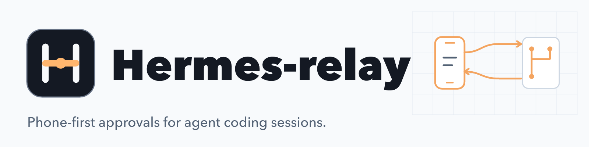
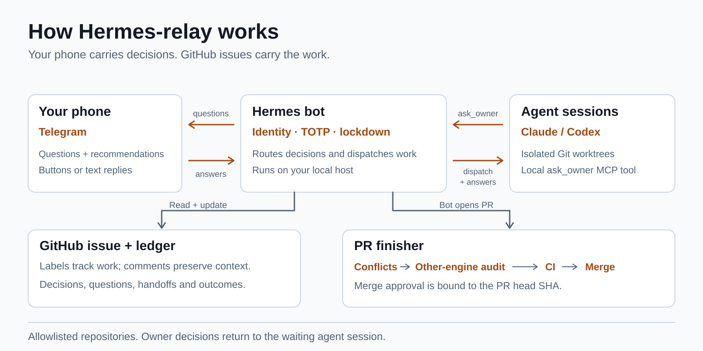

<div align="center">

<picture>
  <source media="(prefers-color-scheme: dark)" srcset="docs/assets/banner-dark.png">
  <source media="(prefers-color-scheme: light)" srcset="docs/assets/banner-light.png">
  
</picture>

### Agent decisions. On your phone.

[](https://github.com/lemun/Hermes-relay/actions/workflows/test.yml)
[](package.json)
[](#running-it-as-a-service)
[](LICENSE)

[Why](#why-hermes-relay) · [Quick start](#quick-start) · [How it works](#how-it-works) · [Features](#features) · [Security model](#security-model) · [Development](#development)

</div>

A phone-first approval loop for agent coding sessions. A Telegram bot sits over a GitHub-issue
pipeline: it relays the decisions only you can make to your phone, carries your answers back into
the live session, dispatches allowlisted Claude/Codex work into isolated Git worktrees, and runs a
gated finisher that takes a pull request from "open" to "merged".

It is built for a single operator. Fork it, point it at your own repositories, and adapt the
pipeline to your workflow.

<p align="center">
  
  <br>
  <sub>A real terminal session on a fresh clone: the doctor fails closed without config, then the
  security tests and the full suite run. No Telegram, GitHub or model is involved.</sub>
</p>

> [!WARNING]
> **hermes-relay runs host-side coding agents from chat.** An authorized Telegram message can cause
> local child processes (Claude Code, Codex, `git`, `gh`) to run on the machine that hosts the bot,
> with that account's files and credentials within reach. Compromise of the Telegram account, the
> bot token, the TOTP seed, the host account, the GitHub credentials or the repository allowlist is
> a path to those host resources.
>
> Run it on a dedicated, trusted macOS account with FileVault and screen lock, narrow repository
> allowlists, and the host-capable modes (`coding.enabled`, `hermes.allowClaudeWriteSessions`) left
> off unless you need them. Read [SECURITY.md](SECURITY.md) and
> [docs/hardening.md](docs/hardening.md) before you start. The test suite is hermetic and starts no
> bot, no agent and no network client.

## Why hermes-relay

Agent coding sessions stall on questions only you can answer: which approach, which trade-off,
whether to merge. Waiting at a terminal for them defeats the point of delegating the work.

- **Decisions come to you.** Agents ask through a local MCP tool; the question lands on your phone
  with a recommended answer and one-tap buttons, and your answer unblocks the waiting session.
- **The issue is the runtime.** Work lives in a GitHub issue; sessions are disposable and a fresh
  one can resume from the ledger comment.
- **Approvals are about one commit.** Push and merge buttons are bound to the head SHA they were
  issued against.
- **Fail-closed by design.** Lockdown, TOTP step-up and single-use button capabilities mean a
  stolen phone or a stale button is not authority.
- **Single operator, your repositories.** Exact numeric Telegram IDs, allowlisted repositories, no
  hosted service in the middle.

## Quick start

Requirements: Node 22 or newer, npm, macOS (the service and hardening tooling target launchd), and
authenticated `gh` plus whichever of `claude` / `codex` you want as engines. Optional: whisper.cpp
and ffmpeg for voice notes.

```sh
git clone https://github.com/lemun/hermes-relay.git
cd hermes-relay
npm ci

cp .env.example .env && chmod 600 .env
cp config.example.json config.json && chmod 600 config.json
```

1. Create a bot with BotFather and put the token in `.env` as `TELEGRAM_BOT_TOKEN`.
2. Run `npm run whoami`, message the bot, and put the chat ID it replies with in `TELEGRAM_CHAT_ID`
   and `TELEGRAM_USER_ID`. Authorization uses exact numeric IDs, never usernames.
3. Generate a base32 TOTP secret, add it to your authenticator app, and set `HERMES_TOTP_SECRET`.
4. In `config.json`, set `hermes.enabled` to `true` and replace the placeholder entries under
   `hermes.repos` with your own local paths and `OWNER/repo` slugs.
5. Create the pipeline labels in each repository: `npm run labels:check -- --repo OWNER/repo`
   lists what is missing, and `npm run labels:bootstrap -- --repo OWNER/repo` creates it.
6. Run `npm run security:check`. It is read-only and fails closed when deployment evidence is
   missing.
7. Start it with `npm run hermes`. A fresh install starts **locked**; unlock locally with
   `npm run security:control -- unlock`.

Config reference: [config.example.json](config.example.json) (non-secret structure) and
[.env.example](.env.example) (secrets).

## How it works

<picture>
  <source media="(prefers-color-scheme: dark)" srcset="docs/assets/how-it-works-dark.svg">
  <source media="(prefers-color-scheme: light)" srcset="docs/assets/how-it-works.svg">
  
</picture>

- **The issue is the runtime.** Each piece of work lives in a GitHub issue moving through a small
  label vocabulary (`needs-grill`, `grilling`, `waiting-input`, `ready`, `implementing`, `pr-open`,
  `finishing`, `blocked`). Sessions are disposable; the issue is the system of record.
- **Ledger comment.** Every session keeps one structured comment on its issue, edited in place:
  decisions, assumptions, questions, answers, a handoff note and the outcome
  ([lib/ledger.mjs](lib/ledger.mjs)). A fresh session can resume from it.
- **Split by job.** A grilling session interrogates an issue and escalates only owner-class
  questions; an implementer works one repository on one branch; a finisher resolves conflicts,
  gets a cross-engine audit from the engine that did not write the code, waits for CI, and merges
  only if all of that holds. One retry per failing stage, then `blocked` with a reason.
- **Ratification relay.** Agents ask through a local MCP tool (`ask_owner`,
  [hermes-ask-mcp.mjs](hermes-ask-mcp.mjs)); the question arrives on your phone with a recommended
  answer and one-tap buttons, and your answer unblocks the waiting session.

The vocabulary is in [CONTEXT.md](CONTEXT.md), the module contracts in
[docs/architecture.md](docs/architecture.md), and the design decisions in [docs/adr/](docs/adr/).

## Features

- **Phone inbox.** One pinned, edited-in-place message shows how many questions are waiting.
- **Telegram commands:** `/status`, `/gh <question>`, `/file <bug or idea>`, `/dispatch repo#issue`,
  `/auto on|off`, `/tiers`, `/ops` or `/doctor`, `/auth <TOTP>`, `/lock`, `/lang he|en|auto`, `/me`,
  `/help`, plus the optional `/code`, `/codestatus`, `/stop`.
- **Voice notes**, transcribed locally with whisper.cpp.
- **Two engines.** Claude and Codex, switchable per issue; the finisher audits with the engine that
  did not write the code.
- **Isolated worktrees.** Allowlisted work runs in its own Git worktree, one repository and one
  branch per implementer.
- **Gated finisher.** Conflicts, cross-engine audit, CI, then a phone-approved merge bound to the
  audited head SHA.
- **Fail-closed lockdown**, lockable from the phone and unlockable only locally.
- **Read-only security doctor** (`npm run security:check`).

## Running it as a service

On macOS it is meant to run as a single per-user LaunchAgent (`com.example.hermes-bot`, rendered
from [launchd/](launchd/)). Rename the label to something of your own in the template first, then:

```sh
npm run install:update -- --root /absolute/path/to/live/checkout            # dry run
npm run install:update -- --root /absolute/path/to/live/checkout --apply    # render the plist
```

The installer only renders files; load or reload the service yourself with `launchctl`. Deployment
and rollback checks, the security doctor and the local unlock flow are in
[docs/hardening.md](docs/hardening.md). `npm run live:check` reports whether the service is
healthy.

## Security model

- **One authorized operator.** Every message and callback must come from the exact configured
  private chat ID and sender user ID. Possessing the phone is not authority.
- **Typed commands: a two-minute TOTP grant.** `/auth <TOTP>` (RFC 6238, a code cannot be reused
  within its time step) opens a process-local step-up grant that expires after two minutes if
  unused. Every mutating or session-spawning command needs a fresh grant and consumes it. A lock,
  an unlock or a restart voids it. Reads, `/status`, `/help` and `/stop` need no grant.
- **Buttons: action-bound, single-use capabilities.** An inline button carries only an opaque random
  ID. The server keeps the binding: user, chat, message, action, repository, target and, for push
  and merge, the expected head SHA. A capability lives two minutes by default (five at most), is
  consumed once, and is burned on any binding mismatch. A sensitive button also needs a live TOTP
  grant at the moment it is pressed
  ([ADR 0006](docs/adr/0006-step-up-action-authorization.md)).
- **Approval is about one commit.** A push or merge button is bound to the head SHA it was issued
  against; the worktree HEAD is re-checked before pushing, the push names the commit explicitly,
  and the merge call passes the audited SHA so GitHub refuses it if the head moved.
- **Lockdown is fail-closed.** First install, state loss or `/lock` starts locked. Locking works
  from the phone; unlocking is local-only. Deferred work re-checks the lockdown generation.
- **Children see less.** Host-capable child processes get an explicit minimal environment
  allowlist instead of the service environment. Codex write sessions run network-off, and the bot,
  not the session, pushes and opens the PR
  ([ADR 0003](docs/adr/0003-bot-owns-push-and-pr-codex-sandbox-closed.md)).
- **Private storage.** Config, state, logs and sockets are owner-only, written atomically, with
  symlink defenses. A singleton lock prevents two pollers consuming the same updates.
- **A read-only doctor** (`npm run security:check`) fails closed when critical deployment evidence
  is missing or unreadable.

### Gates fail closed

If you change the finisher, keep this property: a gate that cannot get an answer must wait, never
pass. `nextFinisherStep` in [lib/finisher.mjs](lib/finisher.mjs) treats an unavailable or malformed
CI response as "wait", not as "no checks, none failing", and an audit approval is bound to the head
SHA it approved, so a new push resets it. The tests that pin this are
`nextFinisherStep: unavailable or malformed CI state waits instead of merging` and
`nextFinisherStep: approved audit is reset when PR head changed` in
[tests/finisher.test.mjs](tests/finisher.test.mjs). More generally, treat "absent" and "empty" as
different states.

## Development

```sh
npm test                  # node --test; hermetic, no Telegram, GitHub, model CLIs or secrets
npm audit --omit=dev
node --check hermes-bot.mjs
sh -n launchd/run-node.sh
```

On macOS you can also lint the LaunchAgent template with
`plutil -lint launchd/com.example.hermes-bot.plist`.

### Migrating from an older install

If you are upgrading an install that used the earlier board integration, `npm run
security:retire-paperclip` removes its leftover settings from `.env` and `config.json`. The
installer and the doctor do not know which LaunchAgent labels your old install used, so remove old
services by hand:

```sh
LABEL=com.example.old-service                 # each label you installed
launchctl list | grep "$LABEL"                # is it still loaded?
launchctl bootout "gui/$(id -u)/$LABEL"       # stop and unload it
rm ~/Library/LaunchAgents/"$LABEL".plist      # remove its definition
```

## Contributing

Pull requests are welcome. Please report security problems privately; see
[SECURITY.md](SECURITY.md).

## License

[MIT](LICENSE), copyright (c) 2026 Shai Sinai.
